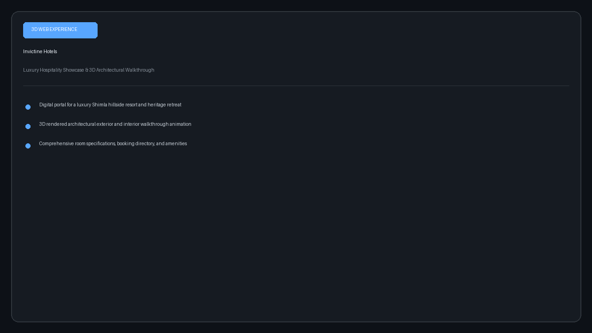
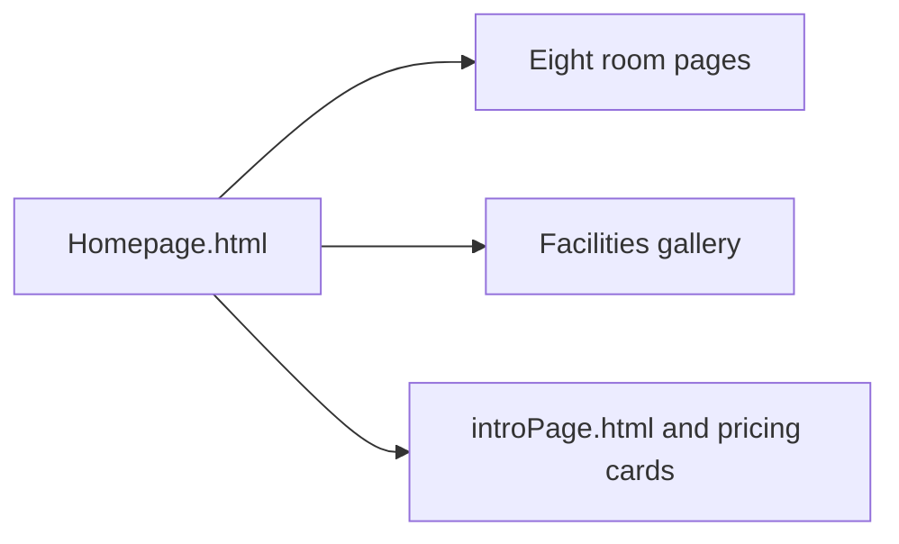

# Invictine Hotels

This school project imagines a Shimla hotel group as a small web of connected pages: browse eight room types, tour the facilities, then jump into a separate pricing microsite with an intro video. It’s a static design exercise with a demo booking button. Borrow the page structure or adapt the concept for your own hospitality project.

*Click preview above to watch recorded interface demo.*

## Tour the site

Open [Homepage.html](AIL%20Website/Homepage.html) from a local copy to explore the properties, facilities, and eight room types. Use the room-pricing link to open [introPage.html](AIL%20Website/introPage.html), which includes the pricing cards and an introductory video.

The booking button opens a demo state. The project is built with HTML, CSS, and JavaScript and runs without a build step.
## Tour the pricing video

<video src="AIL%20Website/0001-1345.mp4" controls width="100%" aria-label="Invictine Hotels project video"></video>

## Page structure

The pages are static HTML, CSS, and JavaScript examples; the booking action is a demo state and there is no hotel reservation backend.
